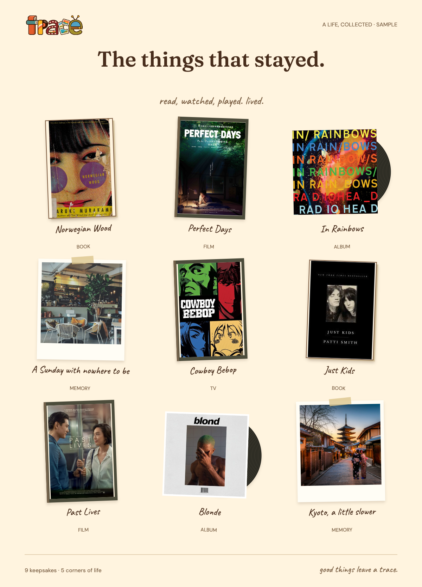
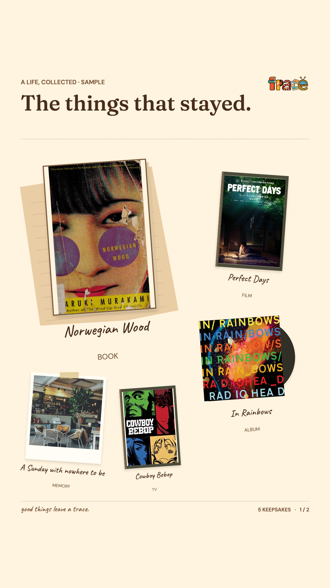
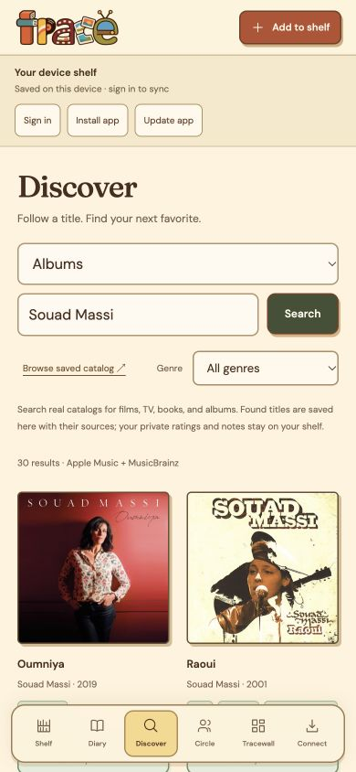
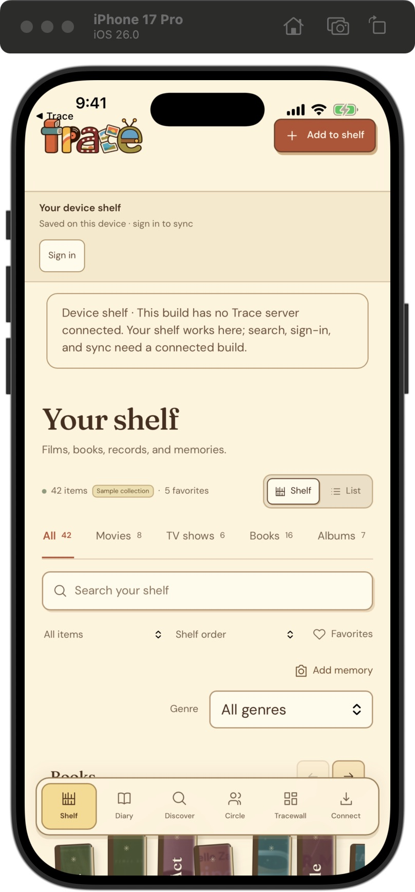
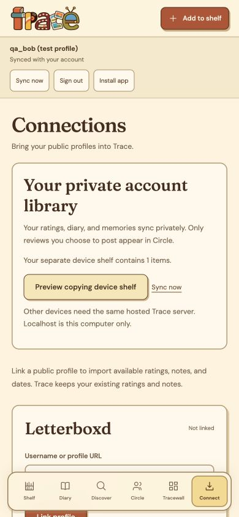

# Trace


A life, collected. Films in a cinema room, books on wooden shelves, records in a jukebox, and memories on a calendar.

Trace brings your media, notes, ratings, and people into one warm little place. Built with browser JavaScript and Python’s standard library—no install step, API key, or paid service required for the core app.


The illustrated identity carries through the app: warm cream, terracotta, mustard, teal, and olive; soft brown outlines; simple shelves, record stands, photo frames, and a playful display serif. The wordmark is made from the five media objects; original covers and personal photos stay readable inside the illustrated frames.

## Make a little room for everything

- **Your shelf:** movies, TV/anime, books, albums, and personal memories. Movies and TV stay separate; music means albums, not individual songs.
- **Dedicated spaces:** Cinema with vertically scrolling DVD/poster columns; a TV lounge; a wooden bookcase; a record-wheel jukebox; a memory calendar; and Diary chapters. All keeps the mixed shelves.
- **Log it your way:** half-star ratings, notes, dates, favorites, For later lists, editable genres, and genre filters. A first tap previews the cover; a second opens details.
- **Discover:** search real catalogs, choose the right release, and save it to your shelf. Results and attribution are cached in SQLite. Cover/genre enrichment preserves your personal ratings and notes.
- **Trace score:** movies combine IMDb, Rotten Tomatoes critics, Rotten Tomatoes audience, and Letterboxd equally on /10, with visible source coverage. A single source keeps its own name. Missing scores stay missing, and your personal rating is separate.
- **Elsewhere:** IMDb, Letterboxd, Goodreads, and other community links on a title. Exact review links are used when IDs are known; otherwise the link is labeled as a search.
- **Your circle:** profiles, following, a public review feed, likes, comments, spoiler controls, editing, and removal with undo. Private account libraries sync ratings, notes, diary entries, and memories separately; only reviews you choose to post enter the feed.
- **Tracewall:** browse logged items in a mini shelf, filter by category, and tap covers to add or remove them from your ordered tray. Customize the paper, then save a Story (1080 × 1920), portrait post (1080 × 1350), square post (1080 × 1080), or full keepsake. Each social PNG uses the preview and follows your pick order. Missing covers become labeled title cards.
- **Take Trace with you:** iPhone/Android home-screen installation and Capacitor native projects, an offline account cache, queued edits, and explicit conflict review. Native debug builds are verified; store distribution remains pending.






Screenshots use sample titles and clearly labeled test profiles. They do not show a real user’s private notes.

The sample shelf includes *Papicha*, *Nedjma*, *Raoui*, and more international titles. The Algiers sample memory photos are credited in [the artwork manifest](assets/sources.json) and licensed under [CC BY-SA 4.0](https://creativecommons.org/licenses/by-sa/4.0/).

## Run locally

Requires Python 3.10+ and a modern browser.

```sh
git clone https://github.com/ACWArob/Trace.git
cd Trace
python3 server.py 5173
```

Open [localhost:5173](http://localhost:5173). Keep the server running for catalogs, images, and shared features. There is no package installation or build step.

Your **guest device shelf** stays in browser localStorage. Signed-in private libraries and memory photos sync to your account in `.trace/trace.sqlite3`; an IndexedDB cache retains account entries, queued edits, and conflicts on that device. Guest shelves are copied only through **Connect → Preview copying device shelf**, with confirmation. Signing out restores the separate guest shelf. Nothing in a private library is posted to Circle automatically. Use **Back up my collection** regularly; it exports the currently open library.

Catalogs, durable provider scores, accounts, private libraries, and explicitly posted reviews share the ignored SQLite database. Set `TRACE_DATA_DIR` to select a different server directory. Database initialization adds tables without replacing the existing catalog, IMDb dataset, or social records.

This is a local development server bound to `127.0.0.1`. A public multi-user deployment needs hosting, HTTPS, account recovery, and moderation. Publishing this repository does not publish your browser collection or server database.

## Bring your history

Link a public Letterboxd/Goodreads profile for available recent feed entries, or import full exports. Public feeds can be unavailable or incomplete.

For **every Letterboxd rating**, export your data, unzip it, and import `ratings.csv` alongside `diary.csv`, `reviews.csv`, `watched.csv`, and `watchlist.csv`. Ratings without diary entries are included and keep unknown watch dates blank. Goodreads library CSV and IMDb ratings CSV are supported too.

Imports preview before saving, match duplicates, preserve existing ratings/notes, and fill missing details. JSON backup/restore retains genres, attachments, ratings, and known diary history. Maximum 10 MB per file and 30,000 rows per batch.

Letterboxd exports/public feeds import your reviews with original links. **Two-way Letterboxd publishing is not enabled:** its [official API](https://api-docs.letterboxd.com/) supports writes through OAuth, but [access requires approval](https://letterboxd.com/api-beta/access/). A profile/feed link is read-only. Other communities’ reviews open on their original sites.

## Catalogs and score sources

The catalog grows through searches; it does not claim to contain every title locally. Fixed provider adapters are attributed, cached, and paced. Core providers are [Wikidata/Wikipedia](https://www.wikidata.org/), [TVmaze](https://www.tvmaze.com/api), [Kitsu](https://kitsu.docs.apiary.io/), [Open Library](https://openlibrary.org/dev/docs/api/search), [MusicBrainz release groups](https://musicbrainz.org/doc/MusicBrainz_API/Search), and [Apple album search](https://developer.apple.com/library/archive/documentation/AudioVideo/Conceptual/iTuneSearchAPI/index.html). TVmaze data is CC BY-SA; retain its links and attribution.

### International search and a populated Browse

The local browse catalog contains **932 attributed entries** as of 2026-11-05: 66 movies, 82 TV shows, 71 anime titles, 237 books, and 476 albums. These counts describe saved provider records, not a complete world catalog. Live search goes beyond those records. Source editions may remain separate; missing artwork and descriptions are never invented.

International discovery is the default starter collection, with Algerian/North African work alongside African, Asian, Middle Eastern, and Latin American creators. Verified searches include *Nedjma*, *ذاكرة الجسد*, *Cien años de soledad*, **دار لفشوش**, and Souad Massi through **سعاد ماسي**. Screen searches select a Wikidata language from the query's script, use work-type claims instead of relying on English descriptions, and retain localized titles/creators. TVmaze has a Wikidata fallback for missing regional shows. MusicBrainz is not restricted to Apple's US store; bounded artist-alias lookup supports non-Latin names. Titles, creators, search fields, and notes use automatic text direction for mixed Arabic/Latin content.

Album search combines MusicBrainz with Apple, accepts albums only, and retains matched source links. Singles, EPs, and tracks are excluded. Provider outages keep the other source's results and retry after a short cache interval. Genre choices stay within the selected category and search. Partial metadata refreshes retain existing covers and descriptions. Obvious non-film catalog mistakes are reversibly excluded from Browse; personal collections are not reclassified.

Populate or refresh a bounded public starter batch:

```sh
python3 catalog_seed.py                                  # dry run: international, 40 queries
python3 catalog_seed.py --apply --report /tmp/trace-catalog-report.json
python3 catalog_seed.py --collection classic             # inspect the original starter plan
```

The command uses at most three workers, honors provider pacing and cached queries, never loads the private ratings key, and makes no credentialed score lookups. Reports contain public aggregate coverage. Existing report files are not overwritten. The ordinary app does not automatically run a population job. Before this development population, the existing database was backed up; original account, review, private-library, and stored-score counts were preserved.

Artwork belongs to its provider record: Open Library cover IDs, Apple collections, MusicBrainz release groups, or the exact Wikidata/Wikipedia work. Same-record size alternatives may recover a missing thumbnail. Failure ends in that item's own labeled title card; another title's image or metadata is never substituted. Remote artwork can still be absent or unavailable. The image-link audit checks availability separately from sampled visual/title matching.

The 2026-11-05 artwork audit checked all 882 supplied URLs in the 932-entry catalog. After bounded retries, same-record alternatives, and eight exact publisher matches on title/artist/release year, **799 entries had available artwork**. Eighty still had unavailable artwork, three links remained inconclusive, and fifty records supplied no image. These gaps use honest title cards. Nine public artwork records and six cached queries were repaired; personal images and library entries were untouched. Audited artwork is retained over an already-confirmed broken thumbnail, while a genuinely different provider image may replace it. Full book and screen covers are fitted without cropping their titles.



Movie Trace scores use four distinct feeds: **IMDb**, **Rotten Tomatoes critics (Tomatometer)**, **Rotten Tomatoes audience (Popcornmeter)**, and **Letterboxd**. IMDb stays on /10, Letterboxd is multiplied by 2, and each RT percentage is divided by 10. All four contribute 25% when present. With two or three, available feeds share the weight equally; missing feeds are never zero. With only one, the badge uses that source’s name and says “not blended.” Coverage always shows “N of 4 sources.” RT percentages measure approval, so the result is a composite consensus score. Duplicate provider copies count once. Metacritic and native Trace community ratings remain visible in details, outside this movie blend.

Other media retain their existing public scores and vote-aware blend: known counts use log₁₀(votes + 1) ÷ 4, bounded from 0.2 to 1, or 0.5 when unknown. Catalog providers include TVmaze, Kitsu, and Open Library. [See the score and source breakdown](assets/screenshots/discover.png).

### Connect the four movie scores

1. Create a free [MDBList account](https://mdblist.com/) and get its API key from **Preferences → API Access**, following the [provider’s setup guide](https://docs.mdblist.com/docs/api).
2. Set **`MDBLIST_API_KEY`** in the Trace server’s environment and restart the server. The key belongs on the server; keep it out of browser storage, chat, screenshots, and Git. Trace does not automatically load `.env` files. For persistent local setup, it also reads an optional `mdblist-api-key` file inside the ignored `.trace/` directory (or `TRACE_DATA_DIR`) at startup. Keep that file readable only by you (`chmod 600`); an environment key takes precedence.
3. Search for a movie in Discover. Matching IMDb IDs get their additional scores in the background; opening a title uses the same lookup. Imported titles without a matched ID need **Find cover & genres** to select the correct release first.

On macOS with zsh, this prompts privately without putting the key in shell history:

```sh
read -s 'MDBLIST_API_KEY?MDBList API key: '
echo
export MDBLIST_API_KEY
python3 server.py 5173
```

Stop an existing Trace server with Ctrl+C before restarting it in that terminal. A key set this way lasts for that terminal session. For hosting, configure the environment variable in the hosting service’s secret settings.

[MDBList’s API](https://api.mdblist.com/docs/) supplies the native rating feeds; **MDBList itself is not a fifth score**. Availability varies by title. The free tier currently allows 1,000 requests/day. Trace requests scores only for displayed catalog results and opened titles, stores provider responses in SQLite, reuses them for seven days, and persists account-wide rate-limit backoff across restarts. Older successful scores are served immediately while a bounded worker refreshes them. An outage never replaces saved successful scores with an empty result. It does not bulk-enrich your collection on startup. API failures preserve available scores and leave missing slots empty. The key is never returned to the browser.

Without that key, IMDb’s local dataset and any already available scores still work; additional slots say **Not available**, with a connection notice. Optional server-only `OMDB_API_KEY` remains a fallback for IMDb, RT critics, and Metacritic. OMDb does not supply the separate RT audience or Letterboxd slots through this adapter. Direct Letterboxd API access and bidirectional publishing remain separate integrations.

For personal/non-commercial IMDb scores, run:

```sh
python3 ratings.py --import-imdb
```

This streams IMDb’s [official ratings dataset](https://developer.imdb.com/non-commercial-datasets/) into the ignored local database. IMDb permits personal/non-commercial copies under its terms; the data is not bundled or redistributed by this repository. Review provider licensing before commercial deployment. OMDb content is [CC BY-NC 4.0](https://www.omdbapi.com/). See [asset provenance](assets/sources.json) for sample covers and photos.

## Private account sync

Sign in using the status bar or Circle. Each account has its own server library and IndexedDB cache; the device shelf remains separate. Sync runs when the library opens, after local changes, when the connection returns, or through **Sync now**. Use the same hosted server/account on each device. Localhost on two separate devices is not the same server.

Edits are stored on the device before the UI reports a save. Pending changes survive refresh. The server uses per-entry revisions and deletion tombstones. If two devices change the same entry, **Review changes** keeps both versions until you choose **Use this device**, **Use account version**, or **Keep both**. Failed sync never silently replaces your device version. Account switching and late network responses are isolated by user ID.

The private API uses authenticated sessions, same-origin writes, CSRF validation, bounded batches, and `Cache-Control: no-store`. `GET /api/library` pulls revision pages; `POST /api/library/sync` submits changes against known revisions. Personal connection/recap preferences are scoped per account in this browser; those preferences are not yet synchronized across devices.

Before applying new tables to an existing installation, back up the database using SQLite’s backup API while the server runs (or copy it with the server stopped). This development migration created an ignored, owner-only backup under `.trace/backups/`. Restore only with the server stopped; keep backups and keys out of Git. Clearing a browser’s site data removes unsynced local edits, so export a backup first.

## Install on iPhone or Android

Use a hosted **HTTPS** Trace URL for phones. On iPhone, open it in Safari and choose **Share → Add to Home Screen**. On Android, open it in Chrome and choose **Install app** (or the browser menu’s install option). The in-app **Install app** button provides platform guidance. Desktop localhost is suitable for development.

The service worker caches a fixed public app shell. API requests, credentials, server session responses, private library JSON, and uploaded photos never enter its CacheStorage. Private offline data belongs in IndexedDB. Public catalogs/feeds require a connection; remote cover images may be unavailable offline. Updates are explicit and refuse to reload over an open form.

This is a home-screen web app, not an App Store/Google Play release. Phone-width layouts, offline edit/reconnect behavior, worker cache behavior, and account isolation are tested. Cold offline launch has **not** been confirmed on a physical Safari/Chrome device; the embedded development browser did not provide a reliable cold-reload result. To verify before distribution: open the hosted app online, install it, close it, enable airplane mode, reopen it, edit an entry, then reconnect and confirm sync.

For an HTTPS reverse proxy, configure `TRACE_PUBLIC_ORIGIN=https://your-trace-domain.example`, preserve that Host header, and proxy to the loopback server. Trace validates the configured origin for writes and marks hosted session cookies Secure. Account recovery, moderation/abuse controls, operational backups, hosting, and native signing/store submission still belong to the release phase.

The detailed five-specialist plan, API contracts, ownership, validation, and native release steps are in [the implementation plan](docs/implementation-plan.md).

### Native iOS and Android

The optional Capacitor projects use the same interface with bundled public assets. Run `npm install` and `npm run native:sync`, then `npm run native:ios` or `npm run native:android`. The default package is explicitly device-only; connect a hosted HTTPS backend to enable catalog search and account sync. Provider keys and the SQL database stay on the server. See [native setup and build commands](docs/native-apps.md).

Verified on 2026-11-04: unsigned iOS simulator build, Android debug APK build, and iPhone simulator launch. A separate temporary iOS probe verified native sign-in/cookie persistence, private JSON writes, CSRF rejection, tombstones, logout, and two-account isolation against a temporary database. Native interaction testing was limited by the simulator control tool; Android runtime testing is pending because the installed emulator is an incompatible Intel/Rosetta version. Physical-device, hosted HTTPS, signing, and store submission remain pending. No store release has been uploaded.

Verification: 73 Node tests and 59 Python tests pass, plus nine real iOS native-HTTP checks. The Android debug APK is generated at `native/android/app/build/outputs/apk/debug/app-debug.apk` (ignored). The native bundle copies 50 explicitly allowed public files. Fresh native diff review is complete.





## Development

Codex guidance lives in [AGENTS.md](AGENTS.md), adapted from [ACWArob’s SWE/global templates](https://github.com/ACWArob/claude-md-templates) using the [official Codex convention](https://developers.openai.com/codex/guides/agents-md/).

```sh
node --test tests/core.test.mjs tests/views.test.mjs tests/library_sync.test.mjs tests/mobile.test.mjs
python3 -m unittest discover -s tests -p 'test_*.py'
node --input-type=module --check < app.js
node --input-type=module --check < social.js
python3 -m py_compile server.py social.py catalog_store.py ratings.py
git diff --check
```

Tests use temporary databases. Browser test accounts and sample reviews are isolated from the real collection. Passwords are scrypt-hashed; sessions use HttpOnly cookies and hashed tokens; writes enforce same-origin and CSRF checks. Database files, exports, passwords, and API keys must never be committed.

## Lessons

2026-10-31 — macOS Python had no trusted CA roots — fall back to the installed system CA bundle when the default context is empty; keep TLS verification enabled.

2026-10-31 — large CSV merges scanned the whole library per row — index by title/provider identity and reuse preview results at confirmation.

2026-11-02 — the first shelf felt like flat cards — keep recognizable physical bindings, compartment depth, and grounded shadows consistent across each media type.

2026-11-02 — backup access disappeared with the mobile sidebar — keep collection export available from the Import page at every viewport.

2026-11-02 — renamed memories could duplicate during backup import — resolve memory IDs before comparing title buckets.

2026-11-02 — the framed wood cabinet felt disconnected from the app — use one continuous room background, restrained ledges, readable labels, and shared native-style controls; avoid decorative slogans.

2026-11-02 — a backdrop-filtered sidebar trapped fixed mobile navigation at the top — clear ancestor filters before anchoring navigation to the viewport.

2026-11-02 — shelf rendering split categories into extra rows — render every category once inside a horizontally scrollable rail; keep the ledge stationary.

2026-11-02 — cover selection opened the editor too early — keep spine selection, cover preview, and entry details as two explicit steps, with ratings visible in details.

2026-11-02 — generic category pages lost their individual character — keep All mixed while Books, Cinema, TV, Albums, Memories, and Diary use their own collection views.

2026-11-02 — a preview could stay selected after filters changed — clear selection on view, category, status, search, or route changes.

2026-11-02 — adjacent-month calendar dates reset when selected — move the displayed month with the selected day.

2026-11-02 — bookcase previews shrank to their spine slots — keep the revealed cover from shrinking inside its fixed-width shelf position.

2026-11-02 — one profile refresh detached another profile’s error message — retain per-provider errors and render them in the current connection panel.

2026-11-03 — a Letterboxd public feed omitted ratings without diary entries — use the full ratings export for complete imports and leave unknown viewing dates blank.
