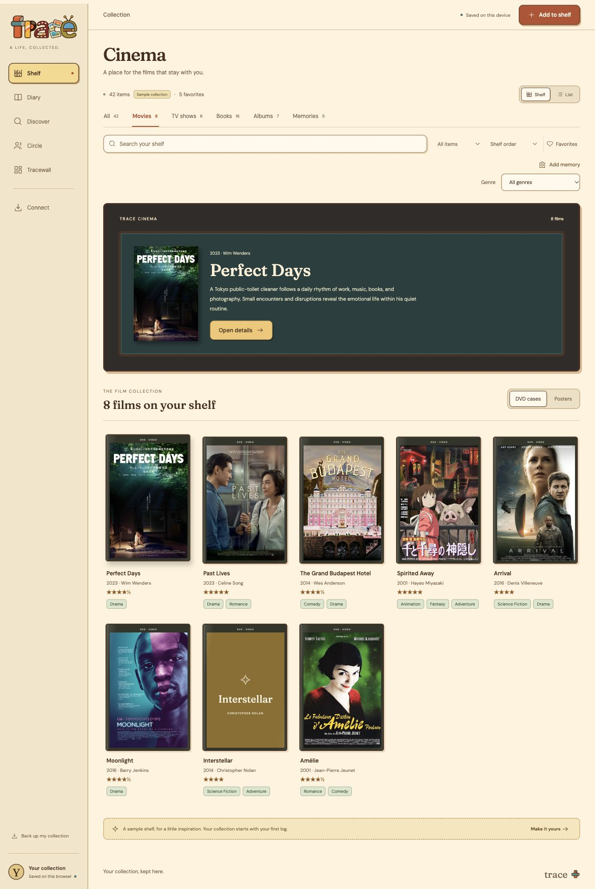
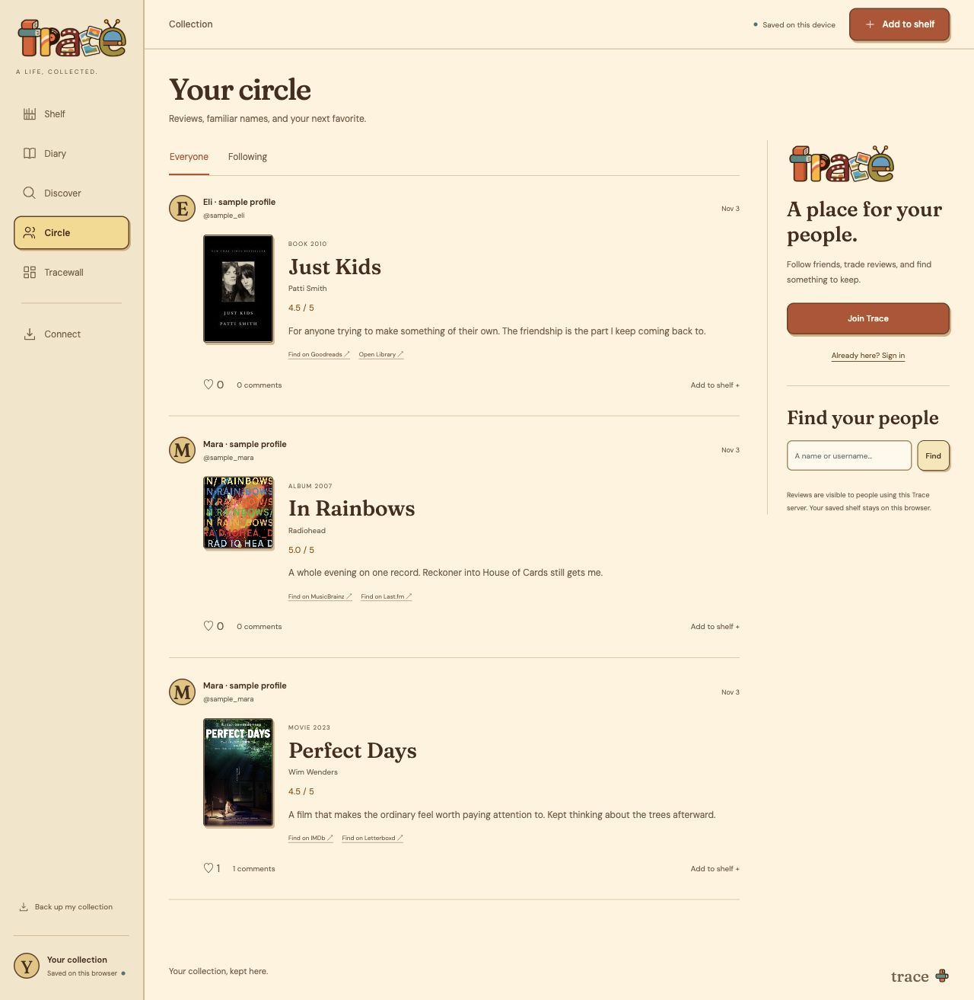
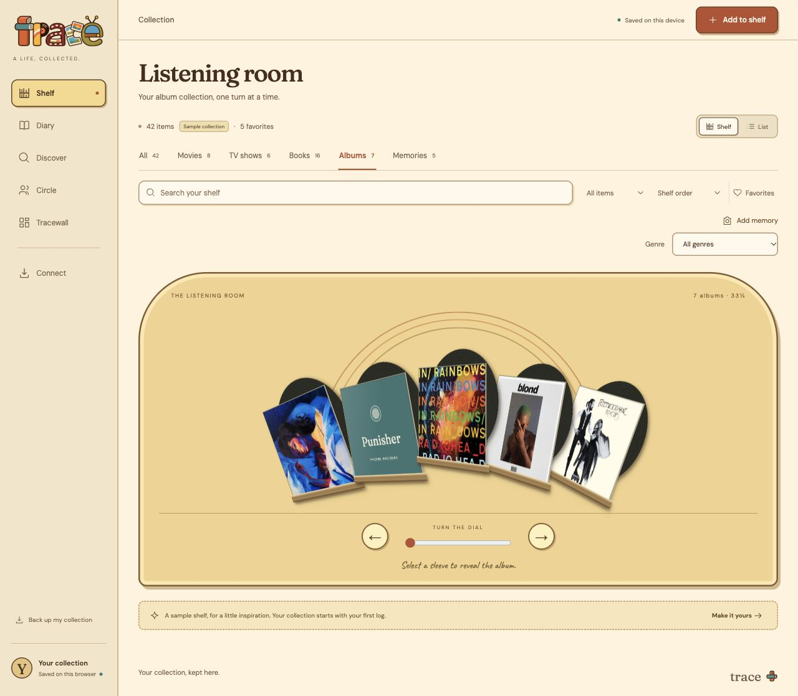

# Trace


A life, collected. Films in a cinema room, books on wooden shelves, records in a jukebox, and memories on a calendar.

Trace brings your media, notes, ratings, and people into one warm little place. Built with browser JavaScript and Python’s standard library—no install step, API key, or paid service required for the core app.



The illustrated identity carries through the app: warm cream, terracotta, mustard, teal, and olive; soft brown outlines; simple shelves, record stands, photo frames, and a playful display serif. The wordmark is made from the five media objects; original covers and personal photos stay readable inside the illustrated frames.

## Make a little room for everything

- **Your shelf:** movies, TV/anime, books, albums, and personal memories. Movies and TV stay separate; music means albums, not individual songs.
- **Dedicated spaces:** Cinema with vertically scrolling DVD/poster columns; a TV lounge; a wooden bookcase; a record-wheel jukebox; a memory calendar; and Diary chapters. All keeps the mixed shelves.
- **Log it your way:** half-star ratings, notes, dates, favorites, For later lists, editable genres, and genre filters. A first tap previews the cover; a second opens details.
- **Discover:** search real catalogs, choose the right release, and save it to your shelf. Results and attribution are cached in SQLite. Cover/genre enrichment preserves your personal ratings and notes.
- **Trace score:** available public ratings are blended into a score out of 10 with transparent, vote-aware weighting. Source values and the formula are visible. Missing scores stay missing, and your personal rating is separate.
- **Elsewhere:** IMDb, Letterboxd, Goodreads, and other community links on a title. Exact review links are used when IDs are known; otherwise the link is labeled as a search.
- **Your circle:** profiles, following, a public review feed, likes, comments, spoiler controls, editing, and removal with undo. Reviews publish only when you choose to post; an existing private shelf is never published automatically.
- **Tracewall:** make a monthly, yearly, or all-time recap and download it as a PNG.





Screenshots use sample titles and clearly labeled test profiles. They do not show a real user’s private notes.

## Run locally

Requires Python 3.10+ and a modern browser.

```sh
git clone https://github.com/ACWArob/Trace.git
cd Trace
python3 server.py 5173
```

Open [localhost:5173](http://localhost:5173). Keep the server running for catalogs, images, and shared features. There is no package installation or build step.

Your collection and uploaded photos stay in this browser’s local storage. Use the same hostname/port, and **Back up my collection** regularly. Catalog data, accounts, and explicitly published reviews live in `.trace/trace.sqlite3`, which is ignored by Git. Set `TRACE_DATA_DIR` to choose a different server data directory.

This is a local development server bound to `127.0.0.1`. A public multi-user deployment needs hosting, HTTPS, account recovery, and moderation. Publishing this repository does not publish your browser collection or server database.

## Bring your history

Link a public Letterboxd/Goodreads profile for available recent feed entries, or import full exports. Public feeds can be unavailable or incomplete.

For **every Letterboxd rating**, export your data, unzip it, and import `ratings.csv` alongside `diary.csv`, `reviews.csv`, `watched.csv`, and `watchlist.csv`. Ratings without diary entries are included and keep unknown watch dates blank. Goodreads library CSV and IMDb ratings CSV are supported too.

Imports preview before saving, match duplicates, preserve existing ratings/notes, and fill missing details. JSON backup/restore retains genres, attachments, ratings, and known diary history. Maximum 10 MB per file and 30,000 rows per batch.

Letterboxd exports/public feeds import your reviews with original links. **Two-way Letterboxd publishing is not enabled:** its [official API](https://api-docs.letterboxd.com/) supports writes through OAuth, but [access requires approval](https://letterboxd.com/api-beta/access/). A profile/feed link is read-only. Other communities’ reviews open on their original sites.

## Catalogs and score sources

The catalog grows through searches; it does not claim to contain every title locally. Fixed provider adapters are attributed, cached, and paced. Core providers are [Wikidata/Wikipedia](https://www.wikidata.org/), [TVmaze](https://www.tvmaze.com/api), [Kitsu](https://kitsu.docs.apiary.io/), [Open Library](https://openlibrary.org/dev/docs/api/search), and [Apple album search](https://developer.apple.com/library/archive/documentation/AudioVideo/Conceptual/iTuneSearchAPI/index.html). TVmaze data is CC BY-SA; retain its links and attribution.

The Trace score normalizes available ratings to /10. Each platform counts once; weights use log₁₀(votes + 1) ÷ 4, bounded from 0.2 to 1, or 0.5 when the count is unknown. A single source is labeled “normalized”; multiple sources are labeled “blended.” [See the score and source breakdown](assets/screenshots/discover.png).

Public scores currently come from TVmaze, Kitsu, Open Library, eligible IMDb records, and published Trace ratings. Availability varies by title; Goodreads and Letterboxd aggregate scores are not supplied by public profile feeds. Optional `OMDB_API_KEY` enables additional IMDb, Rotten Tomatoes, and Metacritic values via OMDb; the key stays on the server. No key is bundled.

For personal/non-commercial IMDb scores, run:

```sh
python3 ratings.py --import-imdb
```

This streams IMDb’s [official ratings dataset](https://developer.imdb.com/non-commercial-datasets/) into the ignored local database. IMDb permits personal/non-commercial copies under its terms; the data is not bundled or redistributed by this repository. Review provider licensing before commercial deployment. OMDb content is [CC BY-NC 4.0](https://www.omdbapi.com/). See [asset provenance](assets/sources.json) for sample covers and photos.

## Development

Codex guidance lives in [AGENTS.md](AGENTS.md), adapted from [ACWArob’s SWE/global templates](https://github.com/ACWArob/claude-md-templates) using the [official Codex convention](https://developers.openai.com/codex/guides/agents-md/).

```sh
node --test tests/core.test.mjs tests/views.test.mjs
python3 -m unittest discover -s tests -p 'test_*.py'
node --input-type=module --check < app.js
node --input-type=module --check < social.js
python3 -m py_compile server.py social.py catalog_store.py ratings.py
git diff --check
```

Tests use temporary databases. Browser test accounts and sample reviews are isolated from the real collection. Passwords are scrypt-hashed; sessions use HttpOnly cookies and hashed tokens; writes enforce same-origin and CSRF checks. Database files, exports, passwords, and API keys must never be committed.

## Lessons

2026-10-31 — macOS Python had no trusted CA roots — fall back to the installed system CA bundle when the default context is empty; keep TLS verification enabled.

2026-10-31 — large CSV merges scanned the whole library per row — index by title/provider identity and reuse preview results at confirmation.

2026-11-02 — the first shelf felt like flat cards — keep recognizable physical bindings, compartment depth, and grounded shadows consistent across each media type.

2026-11-02 — backup access disappeared with the mobile sidebar — keep collection export available from the Import page at every viewport.

2026-11-02 — renamed memories could duplicate during backup import — resolve memory IDs before comparing title buckets.

2026-11-02 — the framed wood cabinet felt disconnected from the app — use one continuous room background, restrained ledges, readable labels, and shared native-style controls; avoid decorative slogans.

2026-11-02 — a backdrop-filtered sidebar trapped fixed mobile navigation at the top — clear ancestor filters before anchoring navigation to the viewport.

2026-11-02 — shelf rendering split categories into extra rows — render every category once inside a horizontally scrollable rail; keep the ledge stationary.

2026-11-02 — cover selection opened the editor too early — keep spine selection, cover preview, and entry details as two explicit steps, with ratings visible in details.

2026-11-02 — generic category pages lost their individual character — keep All mixed while Books, Cinema, TV, Albums, Memories, and Diary use their own collection views.

2026-11-02 — a preview could stay selected after filters changed — clear selection on view, category, status, search, or route changes.

2026-11-02 — adjacent-month calendar dates reset when selected — move the displayed month with the selected day.

2026-11-02 — bookcase previews shrank to their spine slots — keep the revealed cover from shrinking inside its fixed-width shelf position.

2026-11-02 — one profile refresh detached another profile’s error message — retain per-provider errors and render them in the current connection panel.

2026-11-03 — a Letterboxd public feed omitted ratings without diary entries — use the full ratings export for complete imports and leave unknown viewing dates blank.
