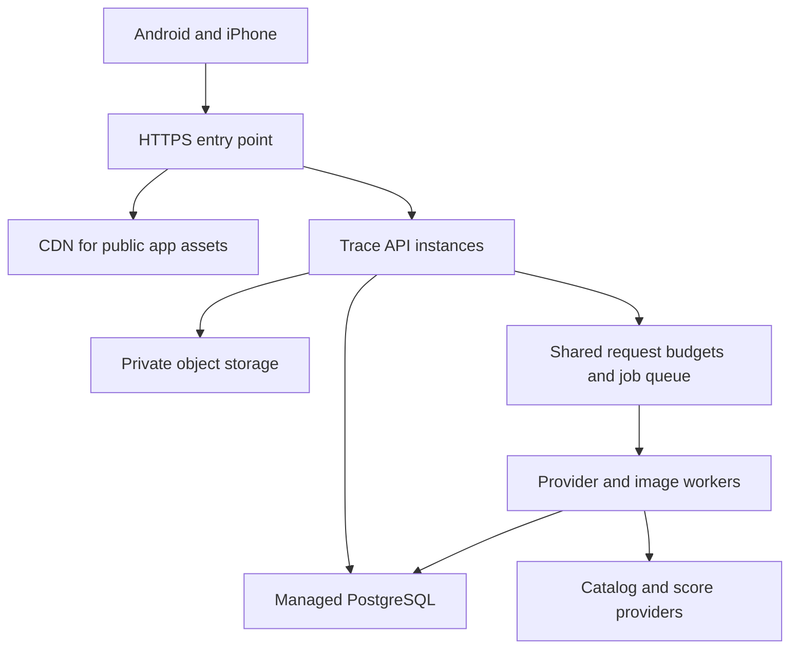

# Trace public launch plan

Prepared November 23, 2026. Target: up to 1,000 daily active users on Android and iOS. This document proposes work; it does not provision services, approve purchases, apply migrations, or submit builds.

## Recommendation and current position

Use the existing Capacitor apps and Python application. Deploy an invited beta first. For the public launch, move shared data to managed PostgreSQL, private photos to object storage, and provider work to a durable background queue. Keep the existing private offline library and conflict handling on phones.

The repository has native projects, release signing configuration, a production server adapter, deployment packaging, SQLite persistence, request limits, account recovery/deletion, and backup tools. Prior local checks passed; they establish a beta foundation. A live deployment, traffic benchmark, offsite restore, production-connected phone tests, signed store releases, and moderation remain launch gates. Recheck the current checkout before implementation; the last release artifacts were prepared November 13.

## 1. Accounts and store requirements

| Item | Android / Google Play | iOS / App Store |
|---|---|---|
| Developer account | Play Console account, identity verification, US$25 one-time registration | Apple Developer Program membership, verification, US$99/year or local equivalent |
| Publisher | Choose personal or organization enrollment based on the real owner; review public developer details | Choose the real individual or legal organization that should appear as seller |
| Package | Owned permanent package ID, signed Android App Bundle, Play App Signing, protected upload key, increasing version code | Owned bundle ID, signing team/provisioning, increasing build number, validated device archive |
| Current tooling | New submissions target Android 16 / API 36 or later; the current project targets 36 | Uploads require Xcode 26+ and iOS 26+ SDK; the previous simulator build used that generation |
| Beta | Internal testing, then the required closed test where applicable | TestFlight; first external build requires beta review |
| Listing | Real screenshots, icon, description, support contact, content rating, audience and app-access declarations | Real screenshots, icon, description, support/privacy URLs, age rating, review access and export-compliance answers |

Sources: [Google enrollment](https://support.google.com/googleplay/android-developer/answer/6112435), [Apple enrollment](https://developer.apple.com/help/account/membership/program-enrollment/), [Android target API policy](https://support.google.com/googleplay/android-developer/answer/11926878), [Apple SDK requirement](https://developer.apple.com/news/upcoming-requirements/?id=04282026a), [TestFlight](https://developer.apple.com/testflight/).

For personal Google developer accounts created after November 13, 2023, plan for at least 12 testers continuously opted in for 14 days before applying for production access. Collect meaningful feedback and fixes. Passing the time threshold does not guarantee approval. [Google testing requirements](https://support.google.com/googleplay/android-developer/answer/14151465)

## 2. Store-readiness work Trace still needs

- Implement report-content, report-user, and block-user controls, objectionable-content handling, an operator moderation queue, and an actual response process. Require agreement to the content rules before posting. Existing removal of your own review is insufficient for a public social app. [Google UGC policy](https://support.google.com/googleplay/android-developer/answer/18265346)
- Supply accurate privacy disclosures, a support contact, retention rules, and completed Google Data safety / Apple App Privacy forms. Add a functional website account-deletion request route as well as the existing in-app deletion flow. Include object storage and backups in the deletion design. [Google deletion requirements](https://support.google.com/googleplay/android-developer/answer/13327111), [Apple privacy details](https://developer.apple.com/app-store/app-privacy-details/)
- Audit the actual iOS archive and SDK privacy manifests. Add the required camera/photo purpose descriptions for the selected device flows and test permission denial. Prefer platform photo pickers rather than broad library permissions. [Apple privacy manifests](https://developer.apple.com/documentation/bundleresources/adding-a-privacy-manifest-to-your-app-or-third-party-sdk)
- Demonstrate the shelves, offline logging, memory photos, imports, and Tracewall sharing in the device app. Review minimum-functionality expectations. If Google account login is added, assess Apple's equivalent privacy-preserving login requirement; Sign in with Apple is the straightforward route. Username/password login already exists. [Apple review guidelines](https://developer.apple.com/app-store/review/guidelines/)
- Give store reviewers working access that does not depend on obtaining a beta invite. Decide the intended audience and launch countries before completing content and privacy declarations. Keep the initial release free unless a separate digital-purchases/billing pass is approved.
- Confirm provider agreements permit the intended hosted use, stored ratings, and cover display. IMDb's downloadable datasets have personal/non-commercial restrictions; API access alone does not establish every required usage right. Disable unresolved sources for release. [IMDb dataset terms](https://developer.imdb.com/non-commercial-datasets/), [OMDb terms](https://www.omdbapi.com/)

## 3. Capacity model

Downloads are not a capacity measurement. Workload depends on active use, sync payloads, cold searches, and photos.

Working assumption: 1,000 daily users × 100 API calls/day = 100,000 calls/day, about 1.2 requests/second on average. A 20× peak is about 23 requests/second. Round the initial sustained test target to 30 requests/second and add a 100 requests/second burst. These are hypotheses to test, not claims about the current server.

The current six-thread Waitress process, two score-refresh workers, SQLite writes, in-process request budgets, and base64 photos are measurable constraints. Adding more API instances first would duplicate provider work and leave budgets uncoordinated. SQLite remains suitable for the single-server beta; PostgreSQL is the recommended path before running several API instances. [SQLite deployment guidance](https://www.sqlite.org/whentouse.html)

## 4. Public-launch architecture

1. **Persistent database:** preserve IDs, personal ratings, notes, dates, attachments, revisions, and deletion tombstones during an explicit tested PostgreSQL migration. Keep session tokens hashed and account authorization server-side. Use a bounded connection pool. A rehearsal must compare counts and field preservation, then exercise concurrent writes and offline replay. Retain a verified pre-migration backup and a rollback path.
2. **Photo storage:** keep private image objects outside the database. Persist stable asset IDs and ownership metadata, resolve short-lived authorized download URLs when needed, and cache phone-local copies for offline use. Do not store expiring URLs as the only image reference. Validate uploads, resize, strip location metadata, enforce quotas, and delete objects with their account. Public CDN caching must never expose private photos or account responses.
3. **Provider queue:** reuse durable cached metadata and scores immediately. Put uncached/enrichment work into bounded jobs with deduplication, backoff, retries, and shared provider budgets. A missing source remains missing. Provider outages must not block private saves or sign-in. Do not crawl every provider title at launch.
4. **Application servers:** begin with one appropriately sized API node and a separate database/storage service. For availability across an API-node failure, add a second node and load balancer, then test one-node operation. Share sessions, budgets, and jobs across instances; retain CSRF/origin checks. Never place the live SQLite file on a shared network drive as a scaling shortcut.
5. **Operations:** separate staging and production accounts, data, origins, and native identifiers. Add external uptime checks, error monitoring without private payloads, disk/database/queue alerts, spend alerts, protected operator access, and documented rollback. Keep provider keys out of packages and logs.

Provider limits are a separate capacity budget. MDBList's free tier currently allows 1,000 calls/day, shared across an account's apps/keys. MusicBrainz normally limits an application to one call/second. Coordinate those limits across workers and confirm commercial-use terms before monetization. [MDBList limits](https://docs.mdblist.com/docs/api), [MusicBrainz API](https://musicbrainz.org/doc/MusicBrainz_API)

## 5. Release gates and load test

Use synthetic accounts and an isolated staging database. Keep production protections enabled and distinguish expected abuse throttling from unexpected failures. Test normal use behind shared Wi-Fi/NAT; budgets should account for users as well as IP addresses.

| Check | Proposed acceptance target |
|---|---|
| Normal traffic | 30 requests/second for 60 minutes with representative shelf, feed, sync, search, and upload traffic |
| Burst | 100 requests/second for 5 minutes; no lost writes or process crash; controlled overload responses |
| Cached API reads | p95 under 400 ms from the test region; report cold external searches separately |
| Small library writes | p95 under 800 ms; retries remain idempotent; no duplicate entries |
| Unexpected server errors | Under 0.5% during the intended load profile |
| Isolation | Zero cross-account reads, photo access, or writes |
| Provider outage | Saved libraries remain usable; cached sources retained; queue/backoff stays bounded |
| Recovery | Real offsite restore succeeds; recommended public-launch targets are RPO ≤15 minutes and RTO ≤1 hour, subject to configured database/storage backup support |
| Availability | Work toward a measured 99.9% monthly SLO with redundancy, monitoring, and rehearsed recovery; do not claim it from a single VM or a load test |

Also test large imports, photo-heavy libraries, password recovery, deletion, conflicting edits, app restart while offline, reconnect, expired sessions, a failed deployment, a database restore, and an API worker being stopped. Repeat critical flows on physical Android and iPhone devices using mobile data with the laptop off. Verify a signed update preserves the library.

Increase capacity based on latency, queue delay, database contention, CPU/memory, provider quota use, and storage growth. A larger VM alone does not remove upstream quotas or improve database failover.

## 6. Working budget in USD

These are planning estimates, not provider quotes or traffic guarantees. Exclude taxes, domain registration, paid catalog rights, API plans, and unusual storage/egress. Review the selected region and exact plans before purchase.

| Stage | Monthly planning allowance | Configuration |
|---|---|---|
| Invited friends beta | $20–40 | Small always-on server, persistent SQLite, real offsite backups, basic monitoring |
| Initial public launch, up to 1,000 DAU | $60–120 | API/worker compute, managed PostgreSQL, private object storage, shared budgets/queue, backups and monitoring; one API node can remain a failure point |
| Greater availability | $150–250 | Two API nodes, load balancer, database standby/failover, shared queue, object storage and operational headroom |

Reference prices currently include a 2 GiB basic Droplet at $12/month, 4 GiB at $24/month, regional load balancing from $12/month, and Spaces storage from $5/month. Managed-database price depends on size and redundancy. These parts do not alone constitute the full operating budget. [Compute](https://www.digitalocean.com/pricing/droplets), [databases](https://www.digitalocean.com/pricing/managed-databases), [load balancer](https://www.digitalocean.com/pricing/load-balancers), [storage](https://docs.digitalocean.com/products/spaces/details/pricing/)

## 7. Implementation sequence

| Phase | Estimated focused engineering time | Files/work areas | Exit evidence |
|---|---|---|---|
| A. Owner setup and hosted beta | 1–2 days, after account access | Existing deploy units, bootstrap, domain and provider configuration; no laptop dependency | HTTPS works from mobile data, restart works, offsite backup restored |
| B. Database and photo foundation | 4–7 days | catalog/social/library/rating stores; new PostgreSQL adapter/migrations; photo API/storage; offline attachment handling | Migration rehearsal preserves private data; photos stay private and survive device restart |
| C. Shared provider queue and operations | 2–4 days | server/score adapters, shared budgets, job workers, monitoring/deployment configuration | Duplicate requests coalesce across instances; provider failure does not block saves |
| D. Public social and store readiness | 3–5 days; can overlap B/C | social backend/UI, moderation roles/queue, deletion webpage, privacy/support, native permission/manifests and store assets | Report/block/removal work; disclosures match the actual app; reviewers have access |
| E. Device and capacity testing | 2–3 days plus tester feedback | New isolated load scenarios and native/device acceptance checks | Capacity and recovery gates pass; signed Android/iOS candidates verified |
| F. Store testing and rollout | External platform waiting time | Google testing track, TestFlight, store submissions, release notes | Required testing and review complete; gradually expanded rollout stays within measured limits |

Allow roughly 2–4 working weeks of engineering if the migration and device checks go smoothly. A new personal Play account's 14-day closed test, identity enrollment, and store review affect calendar time and can overlap other work only once a usable beta exists. This replaces the earlier five-hour beta-preparation scope with a public-launch project.

Five workstreams can be assigned to hosting/operations, data/storage, catalogs/queue, native/store readiness, and independent security/load verification. Keep shared-file integration coordinated and use fresh diff reviews. Approve implementation phases separately, especially dependencies, migrations, paid services, and publishing.

## Owner inputs and launch decision

Needed from the owner: cloud/domain access, developer-account enrollment and verification, chosen seller identity, a public support contact, intended audience/countries, actual testers, and approval of the selected monthly budget. Agreements, payments, identity checks, and final publishing remain owner-controlled steps.

Recommended order: hosted invited beta → measured storage/queue/database foundation → public social safeguards → signed beta testing → capacity/recovery gates → store review → gradual launch. No broad public announcement until the hosted service and phone builds pass those gates.
